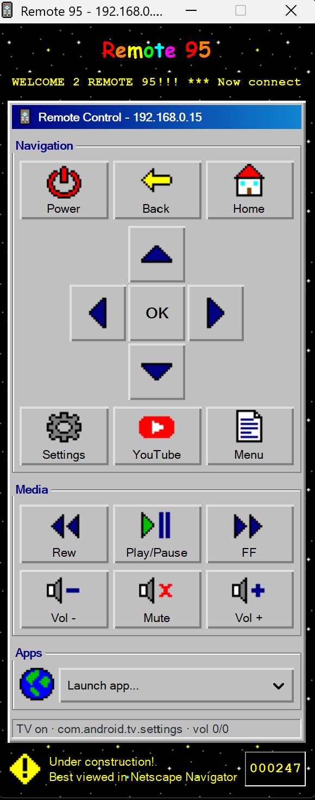

# Remote 95

A desktop remote control for Google TV / Android TV sets, styled like a 90s
homepage: Windows 95 buttons, pixel-art icons, a scrolling marquee and a
"hit counter" that counts your button presses.

<p align="center">
  
</p>

It talks to the TV over your home network using the same protocol as the
Google TV phone app (via the [androidtvremote2] library), so there's nothing
to install on the TV. Tested on a TCL Google TV.

[androidtvremote2]: https://github.com/tronikos/androidtvremote2

## What it can do

- **Navigation:** power, back, home, the D-pad and OK, settings, menu
- **Media:** rewind, play/pause, fast forward, volume up/down, mute
- **Apps:** a YouTube button, and a drop-down to launch Netflix, Prime Video,
  Disney+, Plex, Spotify, Hulu or Max
- **Status bar:** shows whether the TV is on, the app it's showing and the
  volume
- **Keyboard shortcuts** for every button; hover over a button to see its
  shortcut

| Key | Button | Key | Button |
|---|---|---|---|
| Arrow keys | Move | Space | Play / Pause |
| Enter | OK | `<` or `,` | Rewind |
| Backspace / Esc | Back | `>` or `.` | Fast forward |
| H | Home | `+` / `-` | Volume up / down |
| S | Settings | M | Mute |
| N | Menu | P | Power |
| Y | YouTube | | |

## Requirements

- Python 3
- GTK 3 with PyGObject
- `androidtvremote2` (pulls in `cryptography`, `protobuf` and `aiofiles`)
- The PC and the TV on the same network

### Windows (MSYS2)

Install [MSYS2](https://www.msys2.org/), open the **MSYS2 UCRT64** terminal
and run:

```sh
pacman -S mingw-w64-ucrt-x86_64-gtk3 mingw-w64-ucrt-x86_64-python-gobject \
          mingw-w64-ucrt-x86_64-python-cryptography \
          mingw-w64-ucrt-x86_64-python-protobuf mingw-w64-ucrt-x86_64-python-pip
pip install --break-system-packages androidtvremote2
```

(`--break-system-packages` is needed because MSYS2 manages its own Python
packages; `androidtvremote2` isn't one of them.)

### Linux (Debian / Ubuntu)

```sh
sudo apt install python3-gi gir1.2-gtk-3.0 python3-pip
pip install androidtvremote2
```

## Running it

1. Find your TV's IP address. On a Google TV it's under
   **Settings → Network & Internet →** your network.
2. The first time, run it from a terminal with that address:

   ```sh
   python remote95.py <tv-ip>
   ```

3. A pairing code appears on the TV. Type it into the terminal.
4. The remote opens. From then on it remembers the TV, so just run:

   ```sh
   python remote95.py
   ```

On Windows, run it with MSYS2's Python, e.g.
`C:\msys64\ucrt64\bin\python.exe remote95.py`. To get a clickable
icon with no console window, make a shortcut to
`C:\msys64\ucrt64\bin\pythonw.exe` with the full path to
`remote95.py` as its argument, and set its icon to
`remote95.ico`. Pairing and connection errors are printed to the
console, so do the first run from a terminal.

If the TV's IP address changes, run it once more with the new address.

## Where it keeps its data

Everything is saved in a `.remote95` folder in your home folder
(`%USERPROFILE%\.remote95` on Windows), not in this project:

| File | What it is |
|---|---|
| `cert.pem`, `key.pem` | The pairing certificate. Anyone with these can control your TV, so keep them private. Delete them to pair again. |
| `host.txt` | The TV's IP address |
| `clicks.txt` | The hit counter's total |
| `stars.png` | The starfield background, generated on first run |

## Adding a button

Each row of buttons is a list of `(label, action, icon)` entries in
`RemoteWindow.__init__`.

- **Remote key:** use a key name from androidtvremote2 as the action,
  e.g. `('Ch +', 'CHANNEL_UP', 'up')`.
- **App:** add an entry to `APP_BUTTONS`, e.g.
  `'NETFLIX': ('Netflix', 'https://www.netflix.com/title')`, and use
  `'NETFLIX'` as the action.
- **Shortcut (optional):** add the key to `KEYBOARD` and its label to
  `SHORTCUTS`.
- **Icon:** use an existing one from `ICONS`, `None` for no icon, or draw a
  new 16×16 grid using the colour letters in `PALETTE` (`.` is transparent).

## Known limitations

- **Input switching doesn't work on TCL TVs.** The TV ignores the input and
  HDMI keys sent over this protocol, so there are no input buttons.
- Apps given as a package name (Hulu, Max) launch through the Play Store's
  launch link, which depends on the TV's Play Store cooperating. Apps with a
  web or `app://` link are more reliable.

## License

MIT, see [LICENSE](LICENSE).
